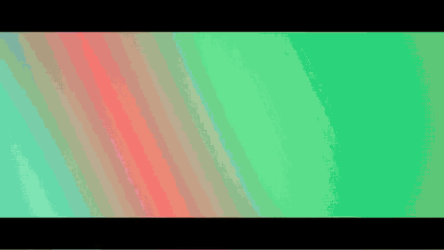
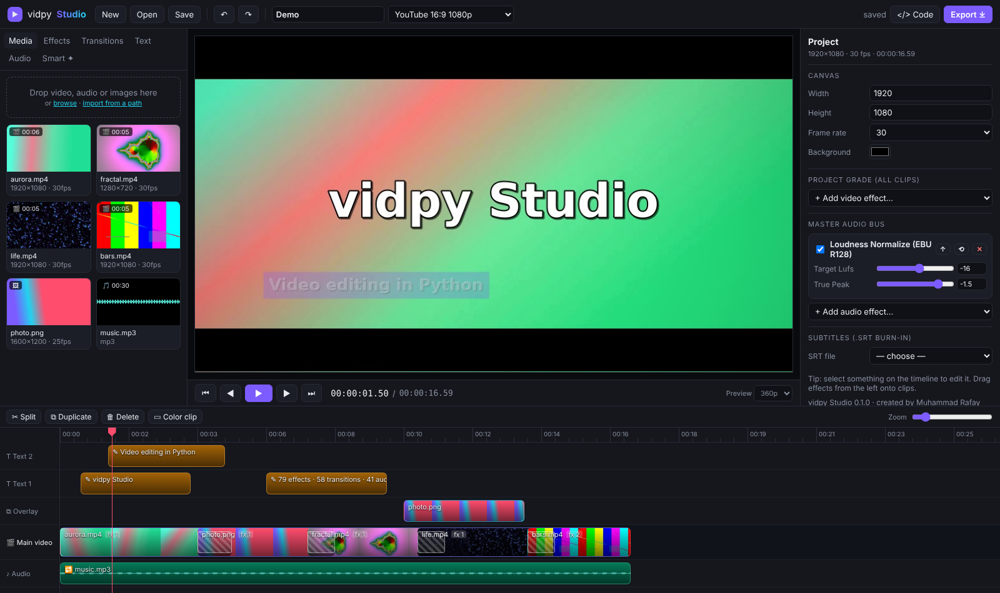
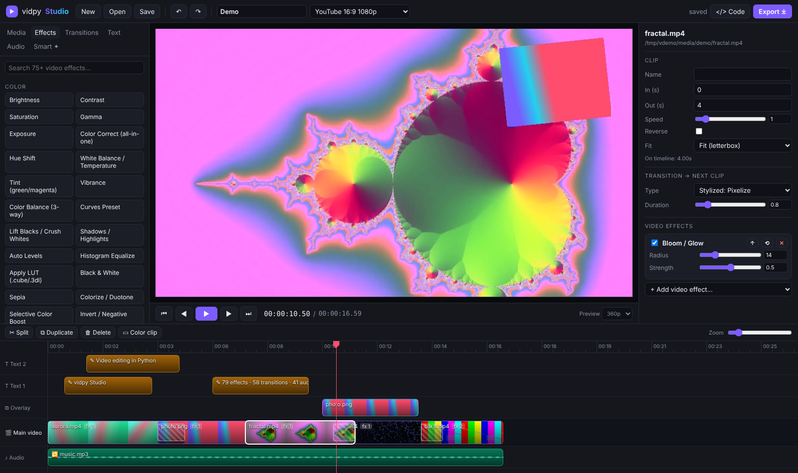
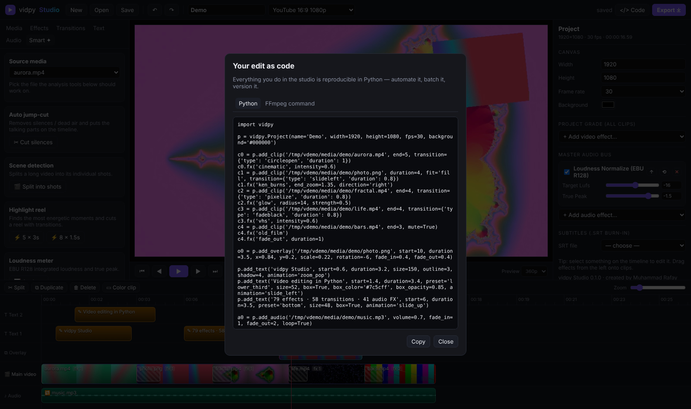

# vidpy: Video Editing in Python

[](https://pypi.org/project/vidpy-ray/) [](https://github.com/rafay183/vidpy/actions/workflows/ci.yml) [](https://pypi.org/project/vidpy-ray/) [](LICENSE) [](CONTRIBUTING.md)

> Install name: **`vidpy-ray`** · command: **`vidpy`** · import: **`import vidpy`**

**vidpy** is an open-source video editor that you install with `pip` and run on your own computer. It gives you a browser-based studio on `localhost`, a Python API and a CLI, all powered by FFmpeg. Cut and arrange clips on a timeline, grade them with cinematic looks, add titles, transitions, green screen and music that auto-ducks under dialogue, then export to MP4, WebM, ProRes, GIF or audio. The core has no Python dependencies beyond the standard library.

```bash
pip install vidpy-ray
vidpy studio      # opens vidpy Studio at http://localhost:8765
vidpy demo        # opens with generated sample media and a ready-made edit
```

Created by **Muhammad Rafay Shaikh, from Pakistan**.





<details><summary><b>More screenshots</b></summary>

| Effects & inspector | Your edit as Python / FFmpeg code |
|---|---|
|  |  |

</details>

---

## Features

| | |
|---|---|
| 🎬 **Timeline editor** | Magnetic main track, unlimited overlay / text / audio lanes, trim, split, ripple-reorder, snapping, undo/redo |
| 🎨 **79 video effects** | Color (3-way balance, curves, LUTs, white balance, vibrance, selective color…), cinematic looks (teal & orange, VHS, noir, cyberpunk, film grain, bloom…), blur/sharpen/denoise, stylize, transform (Ken Burns, stabilize, lens correction, shake…), time (optical-flow slow-mo, strobe…), overlays, and a raw-FFmpeg *Custom* node |
| 🔊 **41 audio effects** | Loudness normalize (EBU R128), voice enhance, noise reduction, de-ess, compressor, limiter, 10-band EQ, pitch shift, robot/chipmunk/deep voice, reverb, echo, 8D audio, stereo widener… |
| 🔀 **58 transitions** | Every FFmpeg `xfade` transition with audio crossfades: dissolves, wipes, slides, shapes, slices, pixelize, zoom… (how many you get depends on your FFmpeg version) |
| ✍️ **Animated titles** | Fade, slide-up, slide-left, zoom-pop, typewriter; boxes, outlines, shadows, any font; burn-in `.srt` subtitles |
| 🟩 **Compositing** | Picture-in-picture, logos, green-screen chroma key, opacity, rotation, fades, layers |
| 🦆 **Smart audio mixing** | Music auto-ducks under dialogue (sidechain), loop to fit, fades, per-track FX, master bus |
| ✦ **Smart tools** | Auto jump-cut (remove silences), scene detection, highlight reel, auto-enhance, reframe to 9:16 / 1:1, loudness meter, two-pass stabilization, compress-to-size |
| ⤓ **12 export formats** | MP4 (H.264/H.265/AV1), WebM (VP9), MKV, ProRes MOV, GIF (palette-optimised), PNG sequence, MP3, WAV, AAC, FLAC; draft → lossless; 360p → 8K; optional GPU encoders |
| 🧑‍💻 **Edit as code** | Every studio edit can be exported as a runnable Python script *and* the exact FFmpeg command |
| 🔌 **Plugins** | Register your own effect with one decorator and it shows up in the studio UI automatically |

---

## Requirements

* Python 3.10+ (Windows, macOS or Linux)
* **FFmpeg** on your `PATH`:
  `winget install ffmpeg` · `brew install ffmpeg` · `sudo apt install ffmpeg`.
  If you can't install it system-wide, use `pip install "vidpy-ray[ffmpeg]"`, which bundles a static build.
  You can also point to a binary with `VIDPY_FFMPEG=/path/to/ffmpeg`.

## The studio (localhost)

```bash
vidpy studio --port 8765 --workspace ~/my-edits
```

* **Media:** drag files into the window, or *import from a path* to use files in place without copying them.
* **Timeline:** double-click media to append it. Drag clips to reorder, and drag their edges to trim. **S** splits at the playhead.
* **Effects / Transitions / Audio:** drag onto a clip, or click to apply to the selection. With nothing selected, they apply to the whole project.
* **Viewer:** scrubbing renders exact frames. **Space** renders a fast preview and plays it.
* **Export ⤓:** pick a format, quality and resolution. Progress shows live, and the file lands in `workspace/exports`.
* **</> Code:** shows your edit as Python and as an FFmpeg command.

Shortcuts: `Space` play · `S` split · `Del` delete · `Ctrl+D` duplicate · `Ctrl+Z / Ctrl+Shift+Z` undo/redo ·
`Ctrl+S` save · `←/→` frame step (Shift = 1 s) · `+/-` zoom · `Esc` deselect.

> The server binds to `127.0.0.1` by default. `--host 0.0.0.0` exposes it on your network; only do that on a network you trust.

## Python API

```python
import vidpy

p = vidpy.Project(width=1920, height=1080, fps=30)          # or p.canvas("shorts_reels_tiktok")

p.add_clip("intro.mp4", start=2, end=8).fx("cinematic").transition_to("circleopen", 1)
p.add_clip("beach.jpg", duration=4).fx("ken_burns", end_zoom=1.4, direction="left")
p.add_clip("talk.mp4").set(speed=1.25).afx("voice_enhance").afx("denoise", reduction_db=15)

p.add_overlay("logo.png", x=0.92, y=0.08, scale=0.1, opacity=0.85, fade_in=0.5)
p.add_overlay("greenscreen.mp4", start=3, x=0.75, y=0.65, scale=0.4).green_screen("#00ff00")
p.add_text("SUMMER 2026", start=0.5, duration=3, size=120, animation="zoom_pop", outline=3)
p.add_audio("music.mp3", volume=0.5, loop=True, duck=True, fade_out=3)

p.fx("film_grain", amount=8)          # whole-project grade
p.afx("normalize", target_lufs=-14)   # master bus

p.render("final.mp4", quality="high")                     # H.264
p.render("final.webm", quality="web", resolution="720p")  # VP9
p.render("teaser.gif", start=0, end=4)                    # any range
p.save("my_edit.vidpy.json")                              # open it in the studio later
```

Progress callbacks: `p.render("x.mp4", on_progress=lambda f, stats: print(f"{f:.0%}"))`

### Smart tools

```python
from vidpy import smart

smart.cut_silences("podcast.mp4").render("tight.mp4")              # auto jump-cut
smart.highlight_reel("match.mp4", clips=6, clip_length=2).render("reel.mp4")
smart.split_scenes("film.mp4")                                     # one clip per shot
smart.slideshow(["a.jpg", "b.jpg"], music="song.mp3").render("show.mp4")
smart.auto_reframe(vidpy.Project.load("edit.vidpy.json"), "9:16").render("vertical.mp4")
smart.stabilize("shaky.mp4", "steady.mp4")
smart.compress_to_size("big.mov", "email.mp4", target_mb=20)
smart.loudness("mix.wav")   # {'integrated_lufs': -15.1, 'true_peak_db': -1.2, ...}
```

### Write your own effect (it appears in the studio automatically)

```python
import vidpy

@vidpy.effect("neon_edges", "Neon Edges", category="My FX",
              params=[vidpy.Param("glow", "float", 6, 0, 30)])
def neon_edges(p, ctx):
    return f"edgedetect=mode=colormix,gblur=sigma={p['glow']},eq=saturation=2"

vidpy.studio()   # launch the studio with your plugin loaded
```

## CLI

```bash
vidpy studio                                  # browser editor
vidpy demo                                    # studio + sample media + demo edit
vidpy version                                 # vidpy and FFmpeg versions
vidpy render edit.vidpy.json out.mp4 -q ultra -r 4k
vidpy convert input.mov output.webm -q web
vidpy jumpcut lecture.mp4 lecture_tight.mp4
vidpy highlights game.mp4 reel.mp4 --clips 6 --length 2
vidpy scenes movie.mp4
vidpy loudness song.wav
vidpy stabilize shaky.mp4 steady.mp4
vidpy compress big.mp4 small.mp4 --mb 25
vidpy effects video | audio | transitions | formats
vidpy info clip.mp4
```

## How it works

A project is plain JSON: clips, overlays, texts, audio and effect stacks. Python, the CLI and the studio all
share that format. At render time, `vidpy.render` compiles the whole timeline into **one** FFmpeg
`filter_complex` graph. That covers trims, speed ramps, effects, `xfade` transitions, overlays, `drawtext`
titles, sidechain ducking and the master bus. Media is decoded once and encoded once, with no
intermediate files or generation loss. Scrubbing renders only the frames under the playhead, so it
stays fast even on long timelines.

## Contributing

Contributions are very welcome, from bug reports and new effects (usually 3–10 lines) to timeline features and translations. Read [CONTRIBUTING.md](CONTRIBUTING.md) to get set up in five minutes, then pick a [good first issue](https://github.com/rafay183/vidpy/issues?q=is%3Aissue+is%3Aopen+label%3A%22good+first+issue%22). Questions and showcases go in [Discussions](https://github.com/rafay183/vidpy/discussions).

Maintainers: the release process is in [docs/PUBLISHING.md](docs/PUBLISHING.md).

## License

MIT © Muhammad Rafay Shaikh
"# vidpy" 
